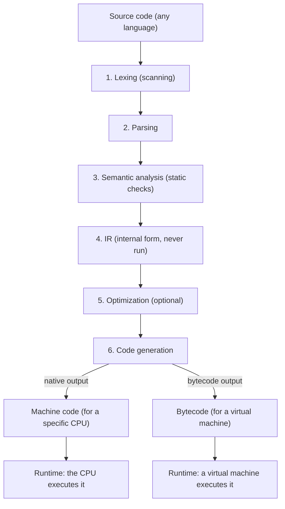
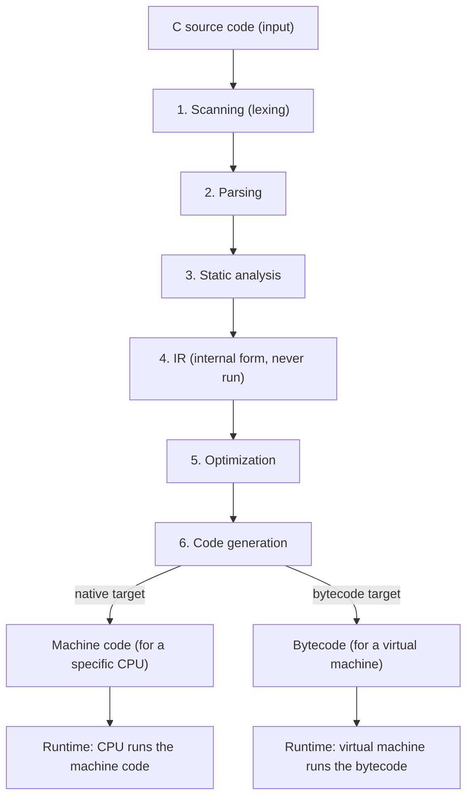

# How Programs Get Run

## Part 1: How any language is compiled (language-agnostic)

Almost every compiler, whatever the language, follows the same general pipeline. The language changes the front end (how it reads your code), but the later stages look similar.



What each stage does, in general terms:

1. **Lexing (scanning):** splits the source text into tokens such as keywords, names, numbers, and symbols.
2. **Parsing:** checks that the tokens follow the language's grammar and builds a tree that shows the program's structure.
3. **Semantic analysis (static checks):** checks meaning without running the program, such as whether a name is defined, whether types match, and whether a variable is used before it is set.
4. **IR (intermediate representation):** the compiler's own simplified language for the program. It is not the source language and not a CPU language, and it is never executed or shipped.
5. **Optimization:** rewrites the IR so the program runs faster or uses less memory, without changing its results.
6. **Code generation:** produces the final output, either machine code for a CPU or bytecode for a virtual machine.

The IR is the key idea. Each source language has its own front end (steps 1 to 3), and each CPU has its own back end (step 6). Optimization happens in the middle, on the IR. So N languages and M CPUs need N front ends and M back ends, not N × M complete compilers.

### How languages differ in when translation happens

There are three main models, and many real languages combine them.

**1. Compiled to machine code ahead of time.** The whole program is translated into machine code before it runs. Examples: C, C++, Rust, Go. It is fast at runtime and needs no translator while running. You must compile separately for each target CPU.

**2. Compiled to bytecode, then run by a virtual machine.** The source is translated into an instruction set designed for a virtual machine, a program that runs other programs. The virtual machine runs the bytecode on any computer it has been ported to. Examples: Java (`javac` produces bytecode for the Java Virtual Machine) and C# (for the .NET runtime).

**3. Interpreted.** An interpreter reads the source, or a simplified form of it, and carries out each step as it goes, without producing a standalone machine-code file. Examples: classic Python and JavaScript. It is quick to develop and portable, but usually slower.

**Hybrid models.** Many modern runtimes mix these approaches:

- **Just-in-time (JIT) compilation** runs bytecode or interprets code at first, then compiles frequently used parts into machine code while the program runs. The JVM and the V8 engine in Chrome and Node.js do this.
- **Python** (the standard CPython implementation) compiles source to bytecode, then a virtual machine interprets that bytecode. This is why `.pyc` files appear in Python projects.

A simple rule: the more translation that happens before the program runs, the faster the startup and the more it depends on the target machine. The more that happens at runtime, the more portable and flexible it is, with some runtime cost.

## Part 2: The same pipeline for C

C is a specific case of the general pipeline, compiled ahead of time to machine code for one CPU.



Compilers and targets:

- **GCC** (GNU Compiler Collection) and **Clang** are compilers. They are the programs that do the translation.
- The **target** is the machine or format the output is meant for, set with a target triple such as `x86_64-linux-gnu` or `aarch64-apple-darwin`.
- Example flags: `clang --target=aarch64-linux-gnu`, `gcc -march=native`.
- `gcc -S file.c` writes the generated assembly (a text form of the machine instructions) to a `.s` file.

Runtime for C: the CPU runs the machine code directly. No compiler or virtual machine is involved.

## Example: the IR for a small function

```c
int add_square(int a, int b) {
    return a * a + b;
}
```

Roughly, in LLVM IR:

```llvm
define i32 @add_square(i32 %a, i32 %b) {
entry:
  %0 = mul i32 %a, %a
  %1 = add i32 %0, %b
  ret i32 %1
}
```

## Example: optimization

`int area = 3 * 4 * width;` can be rewritten by the compiler as `int area = 12 * width;`, so `3 * 4` is calculated once at compile time instead of every time the program runs.

## Example: static analysis

The C code below compiles without errors, but static analysis can find bugs in it without running it:

- `int label;` is not set on every path before `return label;` (uninitialized variable).
- `strcpy(dst, "hello world");` writes 12 bytes into an 8-byte array (buffer overflow).
- `return *p;` reads memory after `free(p)` (use after free).
- `malloc` can return `NULL`, and the code dereferences the result without checking (possible NULL dereference).

Tools used for this: `gcc -fanalyzer`, `cppcheck`, and `clang --analyze`.

## Key takeaways

- Every language goes through the same general stages: read the code, check it, build an IR, optimize, and generate output.
- The compiler translates; the CPU or a virtual machine executes.
- Static analysis checks code before it runs; it is not part of running the program.
- The IR is internal to the compiler and is never executed.
- Optimization keeps the meaning of the program and only changes how fast it runs.
- Languages differ mainly in when translation happens: before running (machine code), before running into a portable form (bytecode), or while running (interpreted or JIT).
