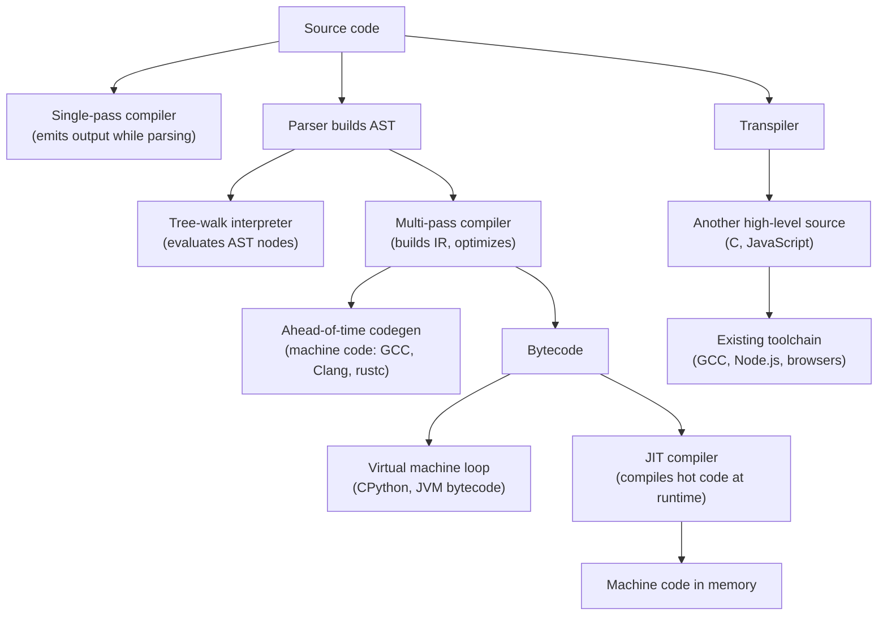

# Compiler and Interpreter Designs

This note covers the alternative routes for turning source code into running behavior, and how they relate to compilers and interpreters. It includes the discussion of single-pass compilers, transpilers (Cython), and JIT compilation.

## Overview

The chapter describes **implementation strategies** for a language, meaning different routes from source code to execution. They are not a complete list of compiler types. Each route trades something (simplicity, startup speed, peak speed, or portability) to avoid the full traditional pipeline.

The main routes are:

- **Single-pass compiler**: parses and emits output in one pass, without building a full syntax tree.
- **Tree-walk interpreter**: parses to an AST (abstract syntax tree) and evaluates it directly.
- **Transpiler**: translates one high-level language into another high-level language.
- **Just-in-time (JIT) compilation**: compiles code to machine instructions while the program runs.

## Diagram: where each design fits

## 1. Single-pass compiler

**What it is.** A compiler that reads the source once and produces output as it goes. It doesn't build a complete syntax tree for the whole program.

**How it works.** The parser consumes one token at a time. As each grammar rule is recognized, the compiler immediately emits the corresponding output, such as bytecode or machine code.

**Complexity.** Processing each token once gives roughly **O(N)** time for N tokens. Symbol-table lookups are usually hash-table operations, which are O(1) on average, so the total stays close to linear.

**Why it doesn't store the whole program.** Because it emits output as it reads, it doesn't keep a tree of the entire program. It still keeps a symbol table (the names, types, and locations it has seen so far), so "doesn't store the whole program" means it doesn't store the whole syntax tree.

**Trade-offs.**

- Fast and memory-efficient.
- Usually requires declarations before use, because the compiler can't look ahead.
- Hard to optimize, since it never holds the whole program at once.

**Real-world example.** The Lua reference compiler generates bytecode directly from its parser in a single pass.

## 2. Tree-walk interpreter

**What it is.** An interpreter that parses source into an AST and then evaluates the tree by recursively visiting each node.

**How it works.** For an expression like `1 + 2 * 3`, the AST has a `+` node with `1` and a `*` node as children. The interpreter evaluates `2 * 3` first, then adds `1`.

**Trade-offs.**

- Easy to build and debug, which makes it a good first implementation.
- Slow, because each step follows pointers, dispatches on node types, and repeats work a compiled program would have done ahead of time.

**Real-world example.** The jlox interpreter in *Crafting Interpreters* is a tree-walk interpreter. Tree-walk interpreters are also a sensible choice for small configuration or domain-specific languages.

## 3. Transpiler (source-to-source compiler)

**What it is.** A compiler whose output is source code in another high-level language, not machine code.

**How it works.** The transpiler reads source and emits equivalent source. Then an existing toolchain for the target language takes over.

**Cython as an example.** Cython takes Cython source, which is mostly Python syntax plus optional C-style type declarations such as `cdef int i`, and generates C or C++ code. A C compiler such as GCC then turns that C into a native extension module that Python can import.

The full path has two stages:

1. **Cython** translates your source into C.
2. **GCC (or Clang)** produces machine code.

Cython alone doesn't produce machine code, which is why it fits the transpiler definition. The overall build still depends on a C compiler.

Cython's input isn't pure Python. Its type declarations and C features make it a Python-like language extended with C features, not a strict subset of Python.

**Is Cython a compiler or a component?** Cython is a **compiler in its own right**. It's a standalone program that reads Cython source and produces C code, which is a complete translation job. It isn't a feature inside GCC or Clang, and those compilers don't use it as a component. The confusion comes from how it's used: Cython only goes as far as C, then hands its output to a separate compiler for the final step.

**Trade-offs.**

- Reuses the target language's runtime, optimizers, and tools.
- Bound by the target's semantics. Error messages from the target can leak through to users.
- Build complexity grows, because you now need both tools.

**Other real-world examples.** TypeScript (`tsc`) produces JavaScript. Babel transforms modern JavaScript into older JavaScript. Elm compiles to JavaScript.

## 4. Just-in-time (JIT) compilation

**What it is.** A compiler that runs while the program is running. It produces machine code for the parts of the program that run often.

**The problem it solves.** An ahead-of-time compiler, like GCC on C, must produce machine code before the program runs. It doesn't know which functions will be called a million times or what types of values will appear. It has to write code that works for every case, which limits speed.

**How it works, step by step.**

1. **Start in a slow mode.** The program begins in an interpreter or as bytecode. It starts immediately, with no long compile step first.
2. **Watch the program run.** The runtime counts how often each function or loop executes and may record the kinds of values it sees, such as whether `a` and `b` are always numbers.
3. **Compile the hot parts.** Once a function is "hot" (called often enough), the runtime compiles it to machine code. Later calls use the fast version.
4. **Keep checking.** The compiled code depends on assumptions, such as "these values are always integers." If an assumption breaks, the runtime falls back to the slower version. This is called **deoptimization**.

**Concrete example.** Take the JavaScript function `function add(a, b) { return a + b; }`, called a million times with numbers. The first calls run in the interpreter. The runtime notices the pattern and compiles a version that does plain integer addition. If someone later calls `add("hi", "there")`, the runtime detects the broken assumption and switches back to the general version, so the result is still correct.

**Why it can beat ahead-of-time compilers.** The JIT sees what the program actually does and can optimize for the paths that are actually taken. On long-running programs, the specialized code can end up faster.

**Costs.**

- **Warm-up:** early code is slow while it's still interpreted or waiting to be compiled.
- **Memory:** the runtime stores compiled machine code and profiling data.
- **CPU competition:** compiling uses CPU time the program could otherwise use.
- **Unpredictable timing:** performance can change during a run, which makes benchmarks and latency harder to reason about.

**Real-world examples.** V8 (JavaScript in Chrome and Node.js) and HotSpot (the main JVM) both use JIT.

## Other designs

- **Ahead-of-time (AOT) compilation** to machine code: C, Rust, Go.
- **Bytecode virtual machines**: the compiler emits compact instructions, and a loop executes them. CPython, the JVM, and Lua's runtime work this way.
- **Multi-pass compilers with an intermediate representation (IR)**: several passes optimize an internal form. LLVM-based compilers such as Clang and `rustc` use this design.
- **Self-hosting compilers**: written in the language they compile. Go and Rust both follow this pattern.

## Comparison

| Design | Output | When translation happens | Startup | Peak speed | Build effort | Example |
|---|---|---|---|---|---|---|
| Single-pass compiler | Bytecode or machine code | Before running | Fast | Limited by no whole-program view | Low to medium | Lua reference compiler |
| Tree-walk interpreter | Nothing (executes AST) | While running | Fast | Slow | Low | jlox |
| Transpiler | Another high-level source | Before running (then the target's toolchain) | Depends on target | Depends on target | Medium | Cython, `tsc` |
| JIT compiler | Machine code in memory | While running | Slow (warm-up) | Can be very high | High | V8, HotSpot |
| AOT compiler | Machine code | Before running | Fast | High | Medium | GCC, Clang, rustc |
| Bytecode VM | Bytecode | Before running, then VM executes | Fast | Medium | Medium | CPython, JVM |

## Classifying a language implementation

The four routes don't form one neat set of categories. These four questions classify an implementation more usefully:

| Question | Options |
|---|---|
| When does translation happen? | Before running (AOT), while running (JIT), or never (direct interpretation) |
| What is the output? | Machine code, bytecode, another source language, or nothing |
| How many passes? | One (single-pass) or many (IR-based) |
| How is it executed? | Native CPU, virtual machine, or a tree walker |

Under this view, a single-pass compiler describes compiler structure, a tree-walk interpreter describes an execution style, a transpiler is a compiler with source-code output, and a JIT is a hybrid. CPython compiles source to bytecode and runs that bytecode in a virtual machine, so it's both a compiler and an interpreter.

## Key takeaways

- The four routes are design choices along a spectrum, not a complete taxonomy.
- "Compiler" versus "interpreter" depends on when translation happens and what gets executed. Many real systems mix the two.
- Each design trades simplicity, startup speed, peak performance, and portability.
- Cython is a standalone compiler whose output is C. A C compiler produces the machine code.
- A JIT compiles code gradually at runtime, based on observed behavior, and can fall back when its assumptions fail.

## Common mistakes

- Thinking "interpreted" means "no translation happens." Even tree-walk interpreters transform the source into a tree.
- Thinking a JIT compiles the whole program once at startup. It compiles hot parts gradually, and different parts may be compiled at different times.
- Assuming JIT is always faster. For short programs, warm-up can make it slower than ahead-of-time compilation.
- Treating Cython as a component of GCC. It's a separate compiler that hands its output to GCC.
- Choosing the most sophisticated design by default. A tree-walk interpreter is often the right choice for a small language.

## Best practices

- Pick the design from your constraints: development cost, expected program length, startup latency, peak performance, and portability.
- Start simple. A tree-walk interpreter is easy to build, test, and debug, and it can be optimized later.
- Measure before optimizing. Benchmark the warm-up cost as well as steady-state speed when evaluating a JIT.

## What a senior engineer would think about

- **Maintainability:** every extra layer (IR, bytecode, JIT) is more code that can fail in production and is harder to debug.
- **Reliability:** JIT deoptimization and unpredictable timing complicate latency guarantees.
- **Operational cost:** a transpiler adds a second toolchain to your build, and a JIT adds memory and CPU overhead at runtime.
- **Developer experience:** error messages from a transpiler's target language can confuse users of your language.
- **Security:** JIT compilers generate executable code at runtime, which is a common target for attacks and needs careful engineering.

## Accuracy notes on the discussion

- The single-pass complexity is roughly O(N) because each token is processed once. The symbol-table lookups it uses are usually O(1) on average, so the total stays close to linear.
- A single-pass compiler doesn't store the whole syntax tree, but it still keeps a symbol table.
- "Cython is a compiler" and "Cython is a transpiler" are both correct. The first describes what it is, and the second describes what its output is.
